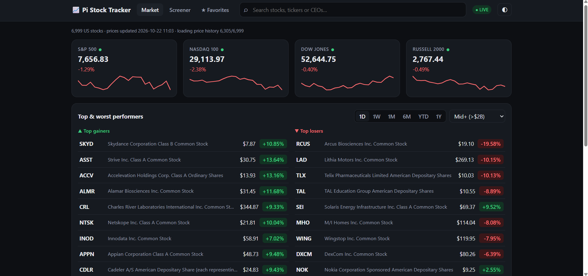

# 📈 Pi Stock Tracker

A web app that runs on a Raspberry Pi and tracks **every US-listed stock** (about 7,000), with live prices, charts, a screener and price alerts on your phone. You only need the Pi. No sensors or add-on boards.

Open it on any phone, tablet or computer: at home on your Wi-Fi, or anywhere with Tailscale.



## Features

- **Market page:** S&P 500, Nasdaq 100, Dow and Russell 2000; the top 10 gainers and losers over 1D, 1W, 1M, 6M, YTD or 1Y, filtered by company size; the most active stocks; and today's sector performance.
- **Screener:** all US stocks in one table. Filter by name, sector or size, sort by any column.
- **Search:** by company name, ticker, or CEO name.
- **Stock pages:** an interactive chart (1 day to the stock's whole history), performance, key stats, and a company profile (CEO, employees, headquarters, website).
- **Live prices (optional):** with a free [Finnhub](https://finnhub.io) key, the stocks you're looking at update with every trade and flash green or red.
- **🔔 Price alerts:** a notification on your phone when a stock rises above or falls below a price, or moves more than a set % in a day. Uses the free ntfy app, with no account needed.
- **Works on every device at once:** your family's phones get live prices too, with nothing to install.
- **★ Favorites**, **light and dark mode**, and a layout that works on phones.
- **Runs by itself:** starts when the Pi boots, restarts if it crashes, and updates with one command.

## 👉 New here? Start with the checklist

**[0. Start here: the whole project, step by step](docs/00-start-here.md)** takes you through all 27 steps in order, from an empty SD card to live prices, phone alerts and access from anywhere. Each step has the exact commands and a "You're done when…" check.

## Step-by-step guides

The checklist links to these when you need more detail. Each one explains every step and command, with a "Problems?" table at the end.

| # | Guide | What you'll do | Needed? |
|---|---|---|---|
| 0 | [**Start here**](docs/00-start-here.md) | The whole project as one checklist, in order | ✅ Start here |
| 1 | [Get your Raspberry Pi ready](docs/01-prepare-the-pi.md) | Install Raspberry Pi OS, turn on SSH, find the Pi's IP, connect from your computer | If your Pi isn't set up yet |
| 2 | [Install the tracker](docs/02-install.md) | Download, install, auto-start, open the website, update, uninstall | ✅ Yes |
| 3 | [Live prices](docs/03-live-prices.md) | Get a free Finnhub key and add it to the Pi | Optional |
| 4 | [Price alerts on your phone](docs/04-price-alerts.md) | Install ntfy, subscribe, test, add alerts | Optional |
| 5 | [Use it away from home (Tailscale)](docs/05-tailscale.md) | Reach the tracker and SSH from anywhere, privately; turn the "VPN" off or remove it | Optional |
| 6 | [Use it on more devices](docs/06-more-devices.md) | Family phones, Add to Home Screen, **safe and unsafe sharing options**, share links, removing access | Optional |
| 7 | [Using the website](docs/07-using-the-website.md) | A tour of every page and button | Recommended |
| 8 | [Cooling fan](docs/08-cooling-fan.md) | Connect a 2-wire case fan and check the temperature | Optional |
| 9 | [Troubleshooting](docs/09-troubleshooting.md) | Every error we've seen and how to fix it | When stuck |
| 10 | [How it works](docs/10-how-it-works.md) | Architecture, API, settings, data files | For curious coders |

## Quick start

For people who already know their way around a Pi. Run these on the Pi over SSH:

```bash
sudo apt install -y git
git clone https://github.com/akshajtripathi24-ui/pi-stock-tracker.git ~/stocktracker
cd ~/stocktracker
python3 -m venv venv
venv/bin/pip install requests websocket-client
bash setup-autostart.sh
```

Then open `http://<your-pi-ip>:8000` on any device on the same Wi-Fi. Find the IP with `hostname -I`.

**Update later:**

```bash
cd ~/stocktracker && git pull && sudo systemctl restart stocktracker
```

## Apps you might want (all free)

| App | What for | iPhone | Android | Computer |
|---|---|---|---|---|
| **ntfy** | Price alert notifications | [App Store](https://apps.apple.com/app/ntfy/id1625396347) | [Google Play](https://play.google.com/store/apps/details?id=io.heckel.ntfy) | not needed |
| **Tailscale** | Using the tracker away from home | [App Store](https://apps.apple.com/app/tailscale/id1470499037) | [Google Play](https://play.google.com/store/apps/details?id=com.tailscale.ipn) | [Download page](https://tailscale.com/download) |

You don't need any app for live prices. Any browser works.

## Most-used commands

| To do this | Run on the Pi |
|---|---|
| Connect from your computer | `ssh pi@<your-pi-ip>` (in Command Prompt or Terminal) |
| Check it's running | `systemctl is-active stocktracker` |
| See the live log | `journalctl -u stocktracker -f` (Ctrl + C to stop watching) |
| Restart it | `sudo systemctl restart stocktracker` |
| Update to the latest version | `cd ~/stocktracker && git pull && sudo systemctl restart stocktracker` |
| Check the temperature | `vcgencmd measure_temp` |
| Find the Pi's IP address | `hostname -I` (home) or `tailscale ip -4` (Tailscale) |

## Safety

- 🔒 **Keep private:** your Finnhub key (`finnhub_key.txt`), your ntfy topic, and your account passwords. Both files are in `.gitignore`, so they never get uploaded to GitHub.
- ✅ **To share with family:** give them the website address at home, or share **just the Pi** through Tailscale with their own account. See [6. Use it on more devices](docs/06-more-devices.md).
- ❌ **Never:** give anyone your email or Tailscale password, or make the Pi public on the internet.
- **Personal use only.** The free data sources used here (Nasdaq, Yahoo Finance, Finnhub) are meant for personal use. Run your own copy for yourself and your household.
- **Not investment advice.** The tracker shows past performance only.

## Tested on

Raspberry Pi 4 (4GB), Raspberry Pi OS Bullseye (32-bit), Python 3.9. It only needs Python 3.9 or newer, so newer Raspberry Pi OS versions should work too.

## License

[MIT](LICENSE). You can use, change and share this project, as long as you keep the copyright notice.
